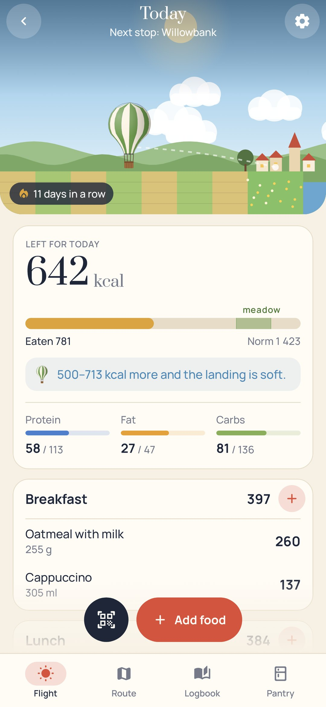
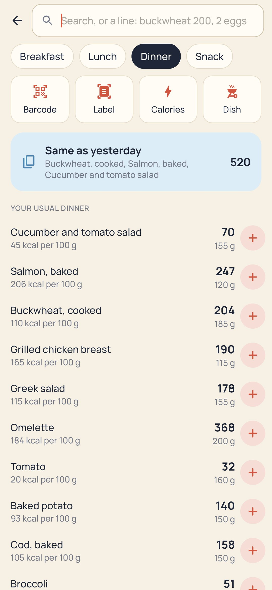
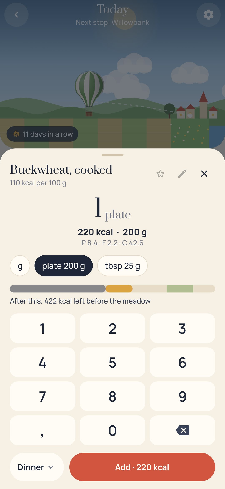
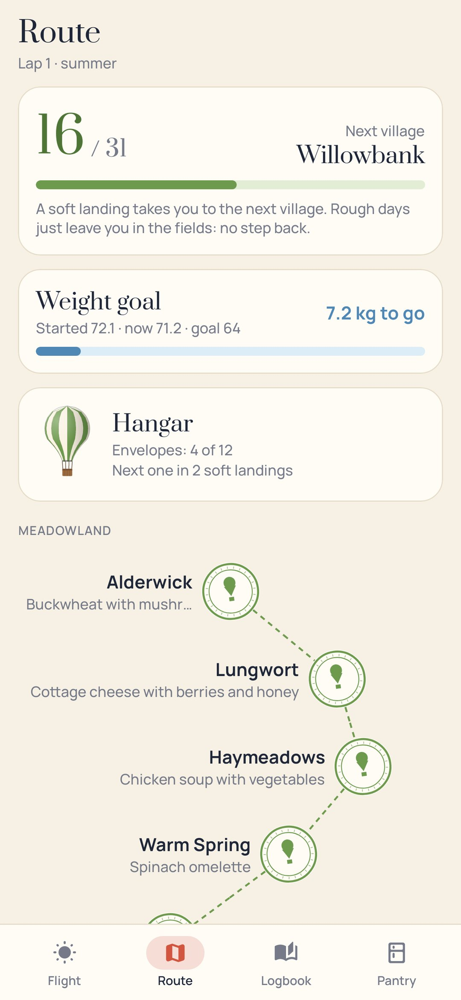

<div align="center">


# Soft Landing

### A calorie counter where every day is a balloon flight to the next village

*In the morning the balloon is light and high; everything you eat is ballast. Land softly on the meadow by evening (your daily norm, give or take) and you reach the next village, which gives you a recipe. Eat too much and you come down early in a farmer's field; too little and the wind carries you past. Logging is fast: barcodes, label photos, one line for a whole meal. Free, no ads, no account.*

[](https://github.com/bigdevwhale/softlanding/actions/workflows/android.yml)


[](LICENSE)

**English** · [Русский](README.ru.md) · [Changelog](CHANGELOG.md)

   

**[Download the APK](https://github.com/bigdevwhale/softlanding/releases/latest/download/SoftLanding.apk)** · Android 9+

</div>

---

## Fast to log

- **Barcodes and QR codes.** Google's code scanner (no camera permission in the app) reads EAN/UPC and the Russian «Честный знак» DataMatrix. Unknown codes are looked up in Open Food Facts and then kept on the phone.
- **A photo of the label.** The nutrition table is read on the phone (ML Kit) and checked against itself: protein×4 + fat×9 + carbs×4 has to come close to the calories. Nothing found? Make the food yourself in a few taps.
- **One line for a meal.** "buckwheat 200, 2 eggs, cappuccino" becomes three entries with one button.
- **Habits first.** "Same as yesterday", your usual foods for each meal, the last amount remembered, a one-tap "+" on every row, and undo.
- **249 everyday foods** with household measures (piece, slice, glass, spoon, plate).
- **Dishes.** Build one from what goes into the pot, scan packs straight into it, weigh the finished pot once; every serving after that is exact. Share a dish as a QR code.
- **Plates and pots** are weighed once and taken off the scales. Eyeball measures (palm, fist, handful) and "just calories" for cafés.
- A day that starts at 4 am, so a late snack still belongs to yesterday. CSV export.

## The game

- **The flight.** What's left of the norm is the balloon's height. A strip shows what's eaten, what a food would add and where the meadow is.
- **Landings.** Soft (in the corridor), early (too much), past the meadow (too little), fog (nothing written down), fair (two days a month for birthdays and holidays, never breaking a run).
- **The route.** 31 villages in the Meadowland, the Lakeland and the Foothills up to Cloud Harbour, each with its own recipe that goes into your dishes in one tap. Laps through the four seasons.
- **The hangar.** Twelve envelope patterns opened by soft landings.
- **The logbook.** A month of coloured landings, a handwritten note from the aeronaut for every day, a week in numbers, the weight line with its goal.
- Enough protein puts a tailwind on the stamp. A gentle evening note comes only if the day is still almost empty.

The norm is Mifflin–St Jeor with your activity and pace, never below a safe floor, or your own number from a doctor or coach.

## Privacy

Everything stays on the phone. Only barcodes and search words go to Open Food Facts, and that can be switched off. The scanner and the label reading run on the phone.

## Build

```
./gradlew testDebugUnitTest assembleDebug                       # app.softlanding.dev
./gradlew assembleDebug -Pdemo                                  # app.softlanding.demo: three weeks of flights
./gradlew testDebugUnitTest -Prender --tests '*RenderScreens*'  # every screen to PNG, EN and RU
python tools/shots.py                                           # README screenshots
python tools/res.py                                             # strings, EN and RU, from one table
```

Fonts: Prata, Manrope, Caveat (SIL OFL). Food values from public nutrition tables; packaged food from [Open Food Facts](https://world.openfoodfacts.org) (ODbL). MIT licence.

Part of [Stillcraft](https://bigdevwhale.github.io/stillcraft/).
