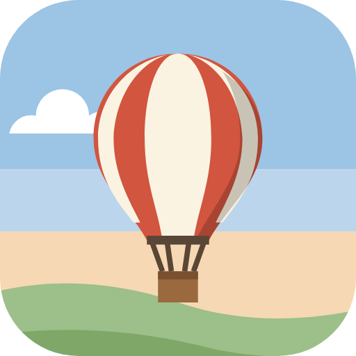
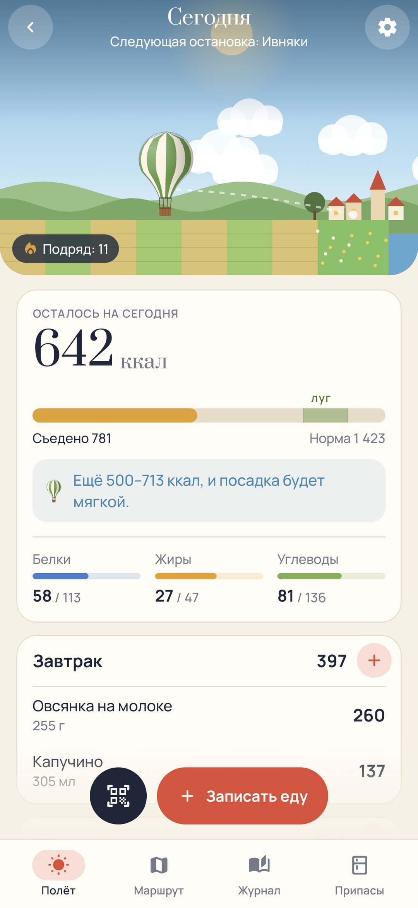
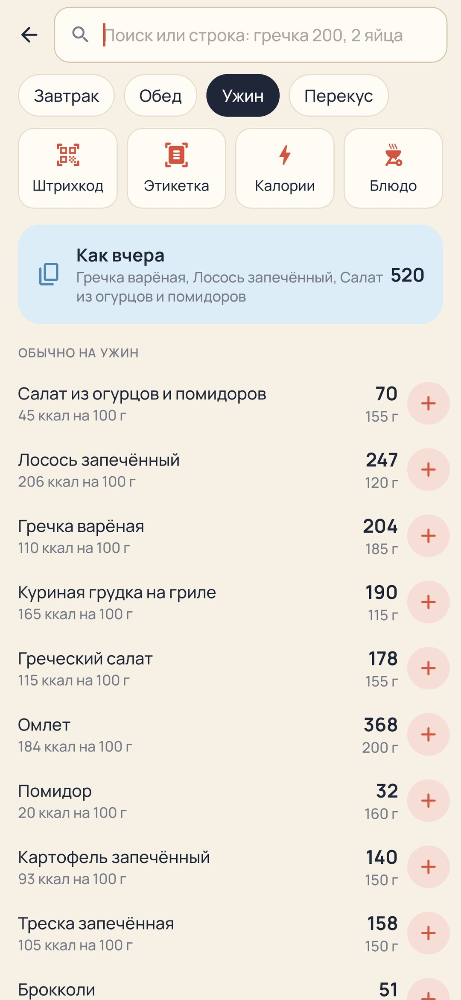
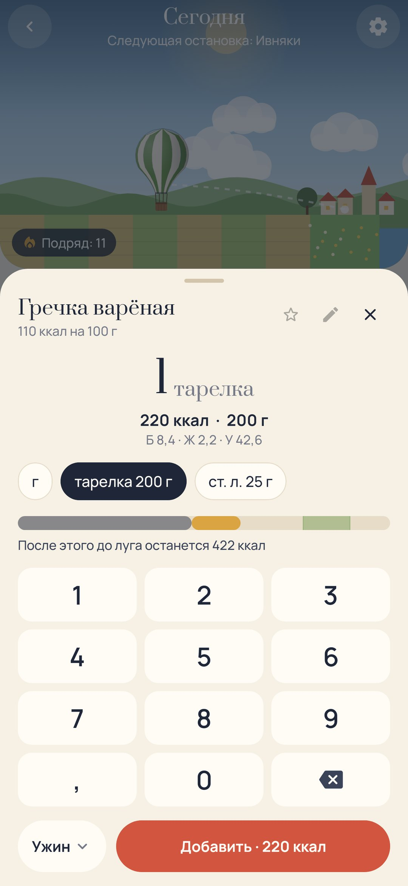
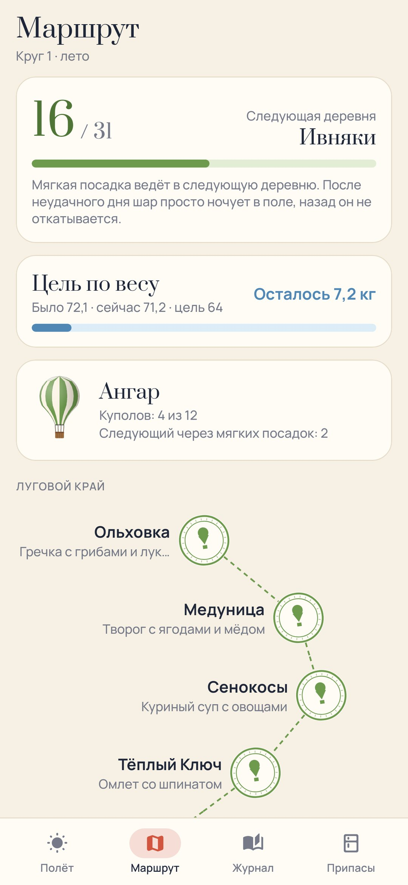

# Мягкая посадка

### Счётчик калорий, в котором каждый день — полёт на воздушном шаре до следующей деревни

*Утром шар лёгкий и летит высоко. Всё, что ты съедаешь за день, — груз, и шар понемногу снижается. Уложишься в свою норму — к вечеру мягко сядешь на луг у следующей деревни, а там тебе подарят рецепт. Переешь — сядешь раньше, в поле у фермера. Недоешь — ветер пронесёт мимо луга. Еду записывать быстро: отсканируй штрихкод, сфотографируй этикетку или впиши весь обед одной строкой. Бесплатно, без рекламы и регистрации.*

[English](README.md) · **Русский** · [Изменения](CHANGELOG.md)

   

**[Скачать APK](https://github.com/bigdevwhale/softlanding/releases/latest/download/SoftLanding.apk)** · Android 9+

---

## Записывать быстро

- **Штрихкоды и QR.** Сканер Google (самому приложению камера не нужна) читает обычные штрихкоды и коды «Честного знака». Незнакомый код ищется в Open Food Facts, а найденное остаётся на телефоне.
- **Фото этикетки.** Таблица читается прямо на телефоне, а цифры сверяются друг с другом: белки×4 + жиры×9 + углеводы×4 должны сойтись с калориями. Не нашлось — продукт можно добавить самому за пару касаний.
- **Приём пищи одной строкой.** «гречка 200, 2 яйца, капучино» — три записи одной кнопкой.
- **Привычное сверху.** «Как вчера», то, что ты обычно ешь на завтрак или ужин, прошлый вес продукта, «+» в одно касание и отмена.
- **249 обычных продуктов** с бытовыми мерами: штука, ломтик, стакан, ложка, тарелка.
- **Блюда.** Собери из того, что идёт в кастрюлю, отсканируй пачки прямо в состав, взвесь готовое один раз — и каждая порция посчитается точно. Блюдом можно поделиться через QR-код.
- **Тарелки и кастрюли** взвешиваются один раз, потом их вес вычитается сам. Есть меры «на глаз» (ладонь, кулак, горсть) и «просто калории» для кафе.
- День начинается в 4 утра, так что поздний перекус относится ко вчерашнему дню. Экспорт в CSV.

## Игра

- **Полёт.** Остаток нормы — это высота шара. Полоска показывает, сколько съедено, сколько добавит продукт и где луг.
- **Посадки.** Мягкая (в коридоре нормы), раньше (перебор), дальше луга (слишком мало), туман (записей нет), ярмарка (два дня в месяц на дни рождения и праздники, серия не прерывается).
- **Маршрут.** 31 деревня: Луговой край, Озёрье, Предгорья и Облачная Гавань. В каждой свой рецепт, он добавляется в твои блюда одним касанием. Круги идут по временам года.
- **Ангар.** Двенадцать куполов, они открываются мягкими посадками.
- **Бортовой журнал.** Календарь посадок, запись аэронавта от руки на каждый день, неделя в цифрах и линия веса с целью.
- Хватило белка — на штампе попутный ветер. Вечером одно мягкое напоминание, и только если за день почти ничего не записано.

Норма считается по формуле Миффлина — Сан-Жеора с учётом активности и темпа и не опускается ниже безопасного минимума. Можно вписать своё число от врача или тренера.

## Приватность

Всё хранится на телефоне. В Open Food Facts уходят только штрихкоды и поисковые слова, и это можно выключить. Сканер и чтение этикеток работают прямо на телефоне.

Часть [Stillcraft](https://bigdevwhale.github.io/stillcraft/).
